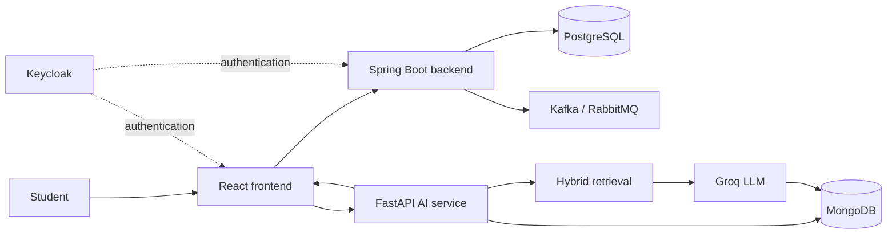

# Architecture

## High-level component view

This is a conceptual view of the documented service boundaries, not a deployment topology. Confirm the exact request path and authentication configuration in the running environment.

## Why separate the AI service?

Resume parsing, retrieval, embedding generation, and LLM inference have different dependencies and resource characteristics from ordinary application CRUD operations. Keeping this processing in a dedicated FastAPI service provides a clear boundary for AI-specific logic and lets the core backend evolve independently.

## Data responsibilities

- **PostgreSQL:** relational application records.
- **MongoDB:** document-oriented records used by the AI workflow, including interview experiences and generated feedback.
- **Kafka and RabbitMQ:** asynchronous messaging infrastructure. Their exact event and queue responsibilities should be checked in the service configuration.
- **Keycloak:** identity and authentication integration.
