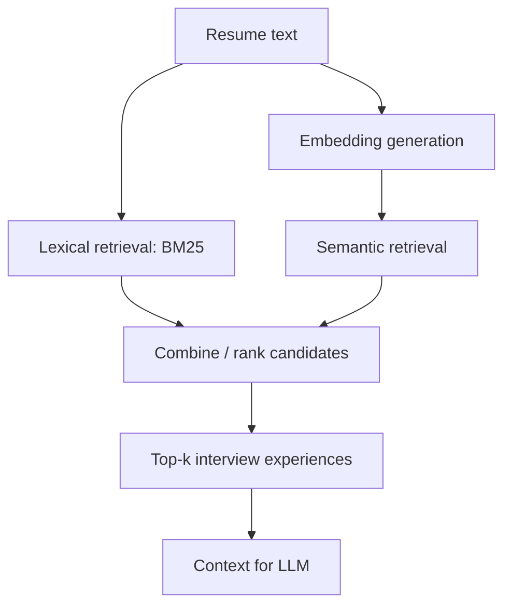

# Hybrid search

## Why hybrid retrieval?

A resume and an interview-experience record may describe the same skill using different words. A keyword-only search can miss that relationship. Conversely, semantic retrieval can overlook exact identifiers such as a company name, framework, or certification.

Hybrid retrieval combines lexical and semantic signals.

## Retrieval channels

### BM25: lexical matching

BM25 is a ranking method based on term relevance. It is useful when exact words matter, such as:

- Java
- Spring Boot
- PostgreSQL
- a company name
- a specific job title

### Sentence-Transformers: semantic matching

A sentence-transformer model converts text into dense numerical embeddings. Similarity between embeddings can surface conceptually related content even when the exact words differ.

For example, a resume phrase about asynchronous messaging may be relevant to an experience that discusses Kafka or RabbitMQ even if the wording is not identical.

## Combining the channels

The project case study describes a hybrid search process that combines BM25 and dense semantic retrieval and selects top-k relevant interview experiences. The exact score-normalization and fusion implementation should be checked in the current `HybridSearcher` source before changing ranking behavior.

## Retrieval quality checklist

- Include representative interview experiences in the catalog.
- Keep company, role, skill, and technology terms consistent.
- Inspect retrieved results for relevance, not just whether the search returned results.
- Evaluate whether top-k results support the feedback being generated.
- Do not let the LLM introduce claims that are unsupported by the retrieved context.
