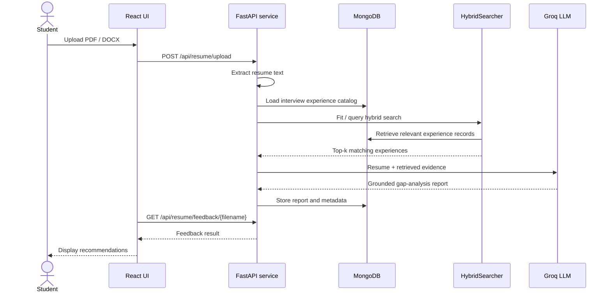

# Resume feedback workflow

The resume-feedback pipeline connects document ingestion with evidence retrieval and LLM-generated analysis.

## End-to-end sequence

## Workflow stages

### 1. Resume ingestion

The student uploads a PDF or DOCX through the React interface. The frontend sends the file to the FastAPI endpoint:

`POST /api/resume/upload`

The service extracts plain text from the uploaded document. This text becomes the query input for the retrieval stage.

### 2. Experience catalog loading

The service loads interview experience records from MongoDB. These records provide the reference material against which resume skills and experience can be compared.

### 3. Hybrid retrieval

The `HybridSearcher` uses complementary retrieval approaches:

- **BM25 lexical retrieval** identifies exact terms such as company names, technologies, and role-specific keywords.
- **Sentence-Transformers semantic retrieval** represents text as embeddings so that conceptually related descriptions can be found even when their wording differs.

The search stage returns the most relevant experience records for the resume.

### 4. LLM synthesis

The service sends the resume content and retrieved experience evidence to the LLM through a structured prompt. The model generates a gap-analysis report using the retrieved context.

The retrieval stage is important: the LLM is given relevant project-specific evidence instead of being asked to produce recommendations from the resume alone.

### 5. Persistence and delivery

The generated report and associated metadata are stored in MongoDB, in the `resume_feedback` collection described by the project case study.

The frontend retrieves the result using:

`GET /api/resume/feedback/{filename}`

It then displays the feedback to the student.

## Failure and accuracy considerations

- A file that cannot be parsed should not be treated as an empty or valid resume.
- Retrieval quality depends on the completeness and quality of the experience catalog.
- LLM output should be reviewed against the retrieved evidence; generated text is not automatically authoritative.
- The exact upload limits, supported MIME types, timeout behavior, and error response schema should be verified in the current API implementation.
